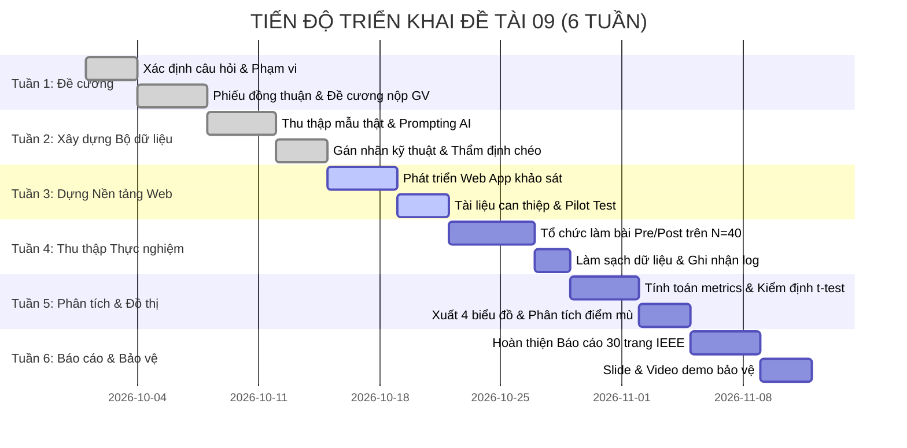

# ĐỀ CƯƠNG CHI TIẾT ĐỒ ÁN MÔN HỌC AN TOÀN THÔNG TIN
**Học phần:** AN TOÀN THÔNG TIN (3 Tín chỉ) - Học kỳ I (2026 - 2027)  
**Giảng viên phụ trách:** TS. Lê Quốc Tuấn  
**Tên đề tài:** Đo hiệu quả nhận diện nội dung lừa đảo được tạo bởi trí tuệ nhân tạo (Mã đề tài: 09)  
**Nhóm sinh viên thực hiện:** Nhóm 3 thành viên  

---

## 1. THÔNG TIN CHUNG VÀ CÂU HỎI NGHIÊN CỨU

### 1.1. Bối cảnh & Tính cấp thiết
Trong bối cảnh bùng nổ của các mô hình ngôn ngữ lớn (Large Language Models - LLMs) và Generative AI, các cuộc tấn công phi kỹ thuật (Social Engineering / Spear-Phishing) đã có bước chuyển biến mang tính bước ngoặt. Trước đây, người dùng thường dựa vào các "dấu hiệu cảm quan" (Linguistic & Visual heuristics) như lỗi chính tả, câu từ vụng về, ngữ pháp dịch máy thô sơ để phát hiện lừa đảo. 

Hiện nay, AI có khả năng tổng hợp nội dung email/tin nhắn đạt mức độ hoàn hảo về văn phong, mô phỏng chính xác phong cách hành chính của nhà trường/doanh nghiệp và cá nhân hóa sâu sắc theo từng nạn nhân. Do đó, các giác quan trực giác của con người không còn là "ranh giới tin cậy" (Trust Boundary).

### 1.2. Câu hỏi nghiên cứu (Research Questions - RQ)
* **RQ1:** Sự xuất hiện của nội dung do AI tạo (AI-generated phishing) làm suy giảm độ chính xác nhận diện của người dùng như thế nào so với lừa đảo truyền thống (Traditional human-written phishing)?
* **RQ2:** Liệu một can thiệp nhận thức ngắn (Intervention Training) tập trung vào **Chỉ dấu Kỹ thuật (Technical Indicators: FQDN, Header, URL, Envelope-From)** và **Quy trình xác minh ngoài băng (Out-of-Band)** có giúp cải thiện đáng kể năng lực phòng vệ của người dùng hay không?
* **RQ3:** Những đòn bẩy tâm lý và dạng thông điệp AI nào gây nhầm lẫn cao nhất đối với sinh viên?

### 1.3. Mục tiêu nghiên cứu
1. Thiết kế và chuẩn hóa bộ benchmark 60 thông điệp giả lập cân bằng (30 Legitimate, 30 Phishing; gồm 15 AI Phishing và 15 Traditional Phishing).
2. Xây dựng đáp án Ground Truth dựa trên 100% bằng chứng kỹ thuật và logic quy trình nghiệp vụ khách quan.
3. Tổ chức thử nghiệm có kiểm soát Pre-test vs Post-test trên $N \ge 40$ người tham gia tự nguyện có ký cam kết đồng thuận và ẩn danh tuyệt đối.
4. Đo lường định lượng và kiểm định thống kê sự chuyển biến về Accuracy, Recall, Precision, F1-Score, thời gian ra quyết định ($T_{\text{decision}}$) và độ tự tin ($C_{\text{confidence}}$).
5. Đề xuất Danh mục kiểm tra nhận diện (Verification Checklist) và Quy trình xác minh ngoài băng (OOB) cho tổ chức.

---

## 2. PHẠM VI NGHIÊN CỨU VÀ GIỚI HẠN AN TOÀN - ĐẠO ĐỨC

### 2.1. Phạm vi kỹ thuật
* **Đối tượng khảo sát:** Người dùng là sinh viên đại học (bao gồm cả khối ngành kỹ thuật CNTT và phi kỹ thuật).
* **Môi trường thử nghiệm:** Chạy nội bộ thông qua ứng dụng Web Form thử nghiệm độc lập trên hạ tầng máy chủ nội bộ/mạng cục bộ của nhóm nghiên cứu.
* **Loại thông điệp:** Email và tin nhắn số hóa mô phỏng các tình huống thực tế trong môi trường đại học (thông báo học phí, cảnh báo bảo mật tài khoản Office 365, học bổng, LMS, tuyển dụng thực tập).

### 2.2. Giới hạn An toàn và Đạo đức (Ethics & Safety Boundaries)
Tuân thủ nghiêm ngặt yêu cầu của Giảng viên và Đạo đức Nghiên cứu An toàn Thông tin:
1. **Không gửi thư giả mạo tới địa chỉ email thật:** Toàn bộ mẫu thư chỉ được hiển thị trên giao diện làm bài của ứng dụng mô phỏng.
2. **Không thu thập thông tin xác thực thật:** Người tham gia không bao giờ được yêu cầu nhập mật khẩu thật, số CCCD thật hay OTP thật. Mọi liên kết đều trỏ về địa chỉ nội bộ giả lập an toàn (`localhost` hoặc trang cảnh báo thử nghiệm).
3. **Ẩn danh hóa 100% dữ liệu:** Mã định danh người tham gia được băm (hash) dạng `PART_001`, không lưu tên hay MSSV trong bộ số liệu công khai.
4. **Đồng thuận tự nguyện:** Mọi người tham gia đều phải đọc và tích chọn Đồng ý trong Phiếu đồng thuận (Informed Consent Form) trước khi bắt đầu bài thử nghiệm.

---

## 3. PHÂN CÔNG NHIỆM VỤ NHÓM 3 SINH VIÊN (RACI MATRIX)

| Thành viên | Vai trò chính | Nhiệm vụ chi tiết |
| :--- | :--- | :--- |
| **Sinh viên 1** (Trưởng nhóm) | Kiến trúc sư An toàn & Trưởng nhóm Nghiên cứu | - Phụ trách xây dựng Đề cương, Mô hình đe dọa (Threat Model) và kiến trúc thực nghiệm. - Thẩm định các chỉ dấu kỹ thuật cho 60 mẫu thông điệp. - Lập trình ứng dụng Web thu thập dữ liệu và giám sát tiến độ. - Viết Chương 1, Chương 3 và Chương 6 của Báo cáo. |
| **Sinh viên 2** | Kỹ sư Sinh dữ liệu AI & Thiết kế Can thiệp | - Thiết kế các bộ Prompt chuyên sâu để sinh 15 mẫu email lừa đảo bằng AI. - Xây dựng Phiếu chấp thuận tham gia và kế hoạch ẩn danh dữ liệu. - Soạn thảo tài liệu can thiệp ngắn (Awareness Intervention Guide & Checklist). - Viết Chương 2 và phụ trách thiết kế Slide thuyết trình, Video Demo. |
| **Sinh viên 3** | Chuyên viên Phân tích Dữ liệu & Thống kê InfoSec | - Thu thập 30 mẫu email hợp lệ và 15 mẫu lừa đảo truyền thống. - Lập trình script xử lý số liệu thống kê (Pandas, Scipy, Sklearn). - Thực hiện kiểm định Paired t-test, Wilcoxon và vẽ các biểu đồ phân tích lỗi. - Viết Chương 4, Chương 5 và lập Bảng truy vết minh chứng. |

---

## 4. KẾ HOẠCH VÀ TIẾN ĐỘ THỰC HIỆN 6 TUẦN

---

## 5. DANH MỤC SẢN PHẨM BÀN GIAO (DELIVERABLES)
1. **Báo cáo toàn văn (25 – 35 trang)** định dạng PDF/Word chuẩn cấu trúc học thuật và trích dẫn IEEE.
2. **Kho mã nguồn hoàn chỉnh (Git Repo)** bao gồm README hướng dẫn cài đặt môi trường, script tái tạo dữ liệu, ứng dụng web khảo sát và script phân tích số liệu.
3. **Bộ dữ liệu 60 mẫu thông điệp chuẩn hóa** ở định dạng JSON và CSV kèm ma trận Ground Truth.
4. **Bộ hồ sơ minh chứng đạo đức:** Phiếu đồng thuận, Kế hoạch ẩn danh hóa và Bản tuyên bố sử dụng AI.
5. **Bộ ấn phẩm phòng vệ:** Verification Checklist 4 bước và Quy trình xác minh ngoài băng OOB.
6. **Bảng truy vết minh chứng (Traceability Matrix)** liên kết 100% mục tiêu với kết quả thực nghiệm.

