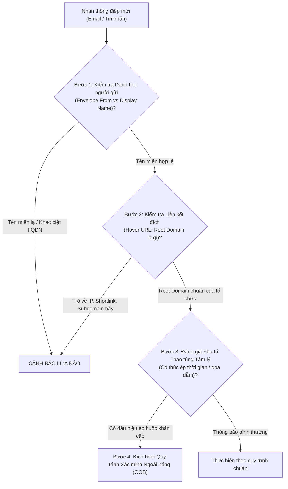
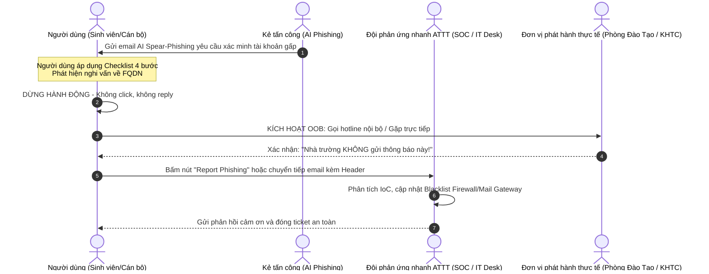

# DANH MỤC KIỂM TRA NHẬN DIỆN KỸ THUẬT & QUY TRÌNH XÁC MINH NGOÀI BĂNG (OUT-OF-BAND)
**Đề tài 09:** Đo hiệu quả nhận diện nội dung lừa đảo được tạo bởi trí tuệ nhân tạo  
**Học phần:** An toàn Thông tin - Giảng viên: TS. Lê Quốc Tuấn  

---

## PHẦN 1: QUY TẮC NHẬN DIỆN KỸ THUẬT 4 BƯỚC (THE 4-STEP TECHNICAL VERIFICATION CHECKLIST)
*Mục đích: Chuyển dịch thói quen người dùng từ "phán đoán theo văn phong/cảm tính" sang "kiểm chứng theo các chỉ dấu kỹ thuật khách quan".*

### Chi tiết 4 Bước Kiểm tra:

#### Bước 1: Rà soát Danh tính Người gửi (Sender Identity & RFC 5322)
* **Quy tắc vàng:** **Không tin tưởng Tên hiển thị (Display Name).** Kẻ tấn công có thể đặt tên hiển thị là "Phòng Đào Tạo Đại Học" hoặc "Ban Quản Trị Hệ Thống" một cách tùy ý.
* **Hành động kỹ thuật:** Nhìn vào địa chỉ email thực tế nằm trong dấu ngoặc nhọn `<...>` hoặc xem header `Return-Path` / `Authentication-Results`:
  * Tên miền sau dấu `@` có phải là tên miền chính thức của tổ chức (ví dụ: `@university.edu.vn`) hay không?
  * Cảnh giác với kỹ thuật lừa đảo tên miền tương tự (Typosquatting / Lookalike): ví dụ `univeristy.edu.vn` (sai vị trí chữ cái), `university-edu.vn.attacker.com` (tên miền phụ lừa đảo).

#### Bước 2: Kiểm tra Liên kết Đích (Link Anatomy & Destination Verification)
* **Quy tắc vàng:** **Không bao giờ nhấp chuột trực tiếp vào liên kết khi chưa kiểm tra.**
* **Hành động kỹ thuật:** Rê chuột (Hover) qua văn bản liên kết hoặc nút bấm để xem URL đích hiển thị ở góc dưới trình duyệt:
  * **Xác định Tên miền Gốc (Root Domain / FQDN):** Đọc ngược từ dấu gạch chéo `/` đầu tiên sang bên trái.
    * *Ví dụ bẫy:* `https://university.edu.vn.portal-auth.cloud/login` $\rightarrow$ Tên miền thực sự là `portal-auth.cloud`, chuỗi `university.edu.vn` chỉ là tiền tố tên miền con (Subdomain) do kẻ tấn công tự đặt!
  * Tuyệt đối không đăng nhập tại các URL trỏ trực tiếp đến địa chỉ IP thô (ví dụ: `http://192.241.178.92/...`) hoặc các dịch vụ rút gọn link (`bit.ly`, `tinyurl`).

#### Bước 3: Nhận diện Đòn bẩy Thao túng Tâm lý (Cognitive Bias Identification)
* **Quy tắc vàng:** AI tạo nội dung rất giỏi đánh vào điểm yếu tâm lý con người.
* **Hành động kỹ thuật:** Tự đặt câu hỏi khi thông điệp chứa các tín hiệu sau:
  1. **Áp lực thời gian cấp bách (Urgency):** "Phải hoàn thành trước 18:00 hôm nay", "Tài khoản bị khóa sau 2 giờ".
  2. **Đe dọa xử phạt (Fear / Intimidation):** "Bị cấm thi", "Khóa dịch vụ vĩnh viễn", "Phạt vi phạm pháp luật".
  3. **Lợi ích tài chính bất thường (Greed / Reward):** "Nhận học bổng 15 triệu", "Hoàn trả tiền dư học phí", "Bản quyền AI Pro miễn phí".
  $\Rightarrow$ **Bất kỳ thông điệp nào kết hợp "Quyền lợi/Đe dọa lớn" + "Thời hạn gấp" ĐỀU LÀ ĐỐI TƯỢNG PHẢI XÁC MINH.**

#### Bước 4: Kiểm tra Tính nhất quán trong Quy trình Nghiệp vụ (Business Flow Consistency)
* Nhà trường và các ngân hàng chính thống **KHÔNG BAO GIỜ** yêu cầu người dùng gửi mật khẩu, mã OTP hoặc thông tin thẻ qua email, form Google hoặc mạng xã hội.
* Mọi giao dịch tài chính hoặc đăng ký học vụ chính thức luôn được thực hiện trực tiếp trên cổng Portal nội bộ mà sinh viên tự gõ địa chỉ trên trình duyệt.

---

## PHẦN 2: CƠ CHẾ BÁO CÁO VÀ QUY TRÌNH XÁC MINH NGOÀI BĂNG (OUT-OF-BAND VERIFICATION FLOW)

### 1. Định nghĩa Xác minh Ngoài băng (Out-of-Band - OOB)
Xác minh ngoài băng là phương pháp kiểm chứng thông tin qua một **kênh liên lạc độc lập, hoàn toàn tách biệt** với kênh nhận thông điệp nghi vấn. Kẻ tấn công có thể giả mạo hòm thư hoặc chiếm quyền email, nhưng không thể kiểm soát đồng thời các kênh độc lập này.

### 2. Quy trình Thực thi OOB 3 Cấp độ trong Tổ chức

### 3. Nguyên tắc Triển khai OOB dành cho Tổ chức:
1. **Quy tắc Kênh Độc lập:**
   * Khi nhận email nghi vấn $\rightarrow$ Xác minh bằng Điện thoại (Hotline niêm yết sẵn trong danh bạ trường) hoặc Ứng dụng trao đổi nội bộ đã xác thực SSO hai lớp.
   * Tuyệt đối không sử dụng số điện thoại hoặc thông tin liên lạc được ghi bên trong chính email nghi vấn đó!
2. **Cơ chế Báo cáo 1-Click (1-Click Phishing Reporting):**
   * Tích hợp tiện ích mở rộng (Add-in) trên hệ thống Webmail (Microsoft Outlook / Roundcube): Nút **"Báo cáo Thư lừa đảo"**.
   * Khi người dùng bấm nút, hệ thống tự động trích xuất toàn bộ Internet Header (bao gồm SPF, DKIM, ARC, IP nguồn) và gửi đến hòm thư chuyên trách `security-incident@university.edu.vn`.
3. **Cơ chế Phản ứng Nhanh của Đội ngũ IT (Defensive Feedback Loop):**
   * Ngay khi nhận được báo cáo OOB, hệ thống SIEM/SOC tự động chặn tên miền lừa đảo trên máy chủ DNS Resolver nội bộ, đồng thời thu hồi (quarantine) toàn bộ các bản sao email tương tự đã gửi vào hộp thư của các sinh viên khác.

