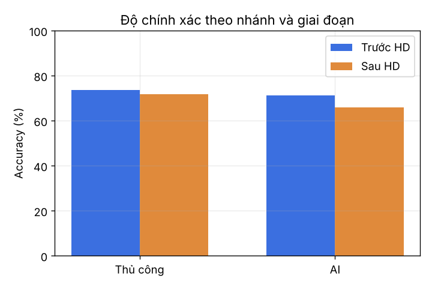
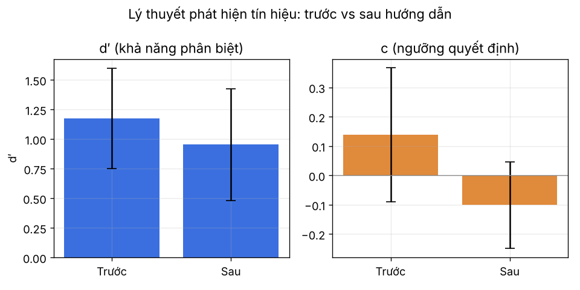
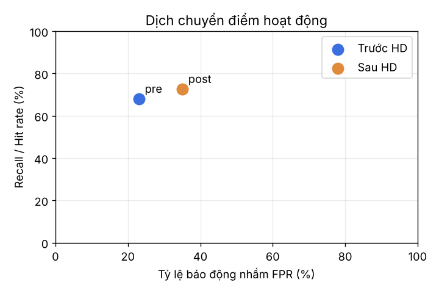
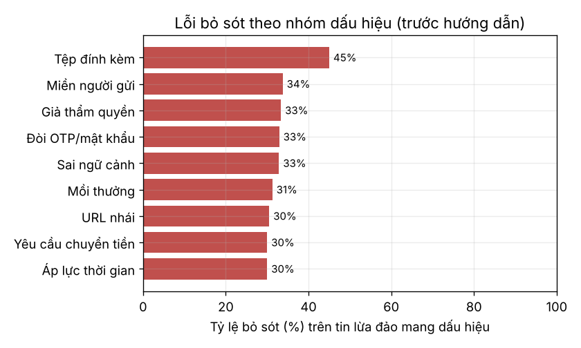
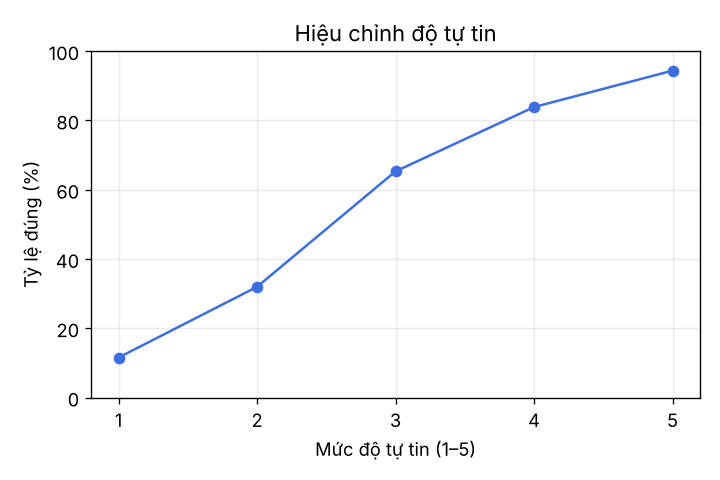

# TRƯỜNG ĐẠI HỌC GIAO THÔNG VẬN TẢI TP.HCM
## KHOA CÔNG NGHỆ THÔNG TIN
### ĐỒ ÁN MÔN HỌC — AN TOÀN THÔNG TIN
### ĐỀ TÀI 9: ĐO HIỆU QUẢ NHẬN DIỆN NỘI DUNG LỪA ĐẢO ĐƯỢC TẠO BỞI TRÍ TUỆ NHÂN TẠO

  

* **Giáo viên hướng dẫn:** TS. Lê Quốc Tuấn  
* **Nhóm sinh viên thực hiện:** Nhóm 9  

| STT | Họ và tên sinh viên | Mã sinh viên |
| :---: | :--- | :---: |
| 1 | **Thân Hoàng Khoa** | **082206011685** |
| 2 | **Nguyễn Hồ Hùng Phương** | **083206006476** |
| 3 | **Huỳnh Thanh Vũ** | **060207000288** |

*Thành phố Hồ Chí Minh, năm 2026*

---

## Tóm tắt
Nội dung do AI sinh ra khiến thư/tin nhắn lừa đảo trở nên trôi chảy và được cá nhân hoá, làm suy yếu các dấu hiệu nhận biết truyền thống dựa trên ngôn ngữ. Đồ án này xây dựng một bộ dữ liệu 60 thông điệp mô phỏng cân bằng theo hai chiều — tính hợp lệ (hợp lệ/lừa đảo) và nguồn tạo (viết thủ công/AI hỗ trợ) — rồi dùng một ứng dụng khảo sát cục bộ để đo khả năng nhận diện của người tham gia theo thiết kế trước–sau hướng dẫn. Chúng tôi phân tích bằng các chỉ số phân loại (accuracy, precision, recall, FPR) kết hợp lý thuyết phát hiện tín hiệu ($d'$, criterion) để tách bạch khả năng phân biệt khỏi xu hướng quyết định, và so sánh con người với một bộ phát hiện theo quy tắc. Toàn bộ thực nghiệm tuân thủ ranh giới an toàn: tổ chức và tên miền hư cấu, không gửi thư tới địa chỉ thật, không thu thập thông tin định danh.

**Từ khoá:** *phishing, nội dung do AI tạo, kỹ nghệ xã hội, lý thuyết phát hiện tín hiệu, nhận thức an ninh, nhận diện của con người.*

Thực nghiệm với 20 người tham gia (1200 lượt trả lời) cho độ chính xác chung 70,7%. (RQ1) Trước hướng dẫn, tỷ lệ bắt tin lừa đảo do AI hỗ trợ (69,3%) không khác có ý nghĩa so với tin viết thủ công (66,9%); thay vào đó có xu hướng (chưa đạt ý nghĩa thống kê) là tin HỢP LỆ do AI viết bị nghi nhầm nhiều hơn. (RQ2) Sau hướng dẫn ngắn, khả năng phân biệt $d'$ không tăng (1,20 → 0,98) trong khi ngưỡng quyết định dịch rõ rệt về phía nghi ngờ ($c$: 0,13 → -0,11), kéo tỷ lệ báo động nhầm từ 23,0% lên 35,0%. (RQ3) Người tham gia dựa nhiều nhất vào dấu hiệu hối thúc và yêu cầu OTP; dấu hiệu 'chất lượng ngôn ngữ' cho tỷ lệ đúng thấp hơn mức chung. Bộ phát hiện theo quy tắc đạt 95,0% trên cùng bộ tin, cao hơn hẳn con người, nhưng bỏ sót chiêu lừa thuần tâm lý mà phần lớn người tham gia nhận ra.

---

## Mục lục
* **Tóm tắt**
* **Chương 1. Giới thiệu và xác định vấn đề**
  * 1.1. Bối cảnh
  * 1.2. Câu hỏi nghiên cứu
  * 1.3. Phạm vi, giả định và ranh giới an toàn
  * 1.4. Đóng góp
* **Chương 2. Cơ sở lý thuyết**
  * 2.1. Kỹ nghệ xã hội và thiên lệch nhận thức
  * 2.2. Dấu hiệu tạo áp lực và giả mạo thẩm quyền
  * 2.3. Nội dung tổng hợp (AI) giả mạo và cá nhân hoá
  * 2.4. Giới hạn của nhận diện bằng cảm quan
  * 2.5. Lý thuyết phát hiện tín hiệu (Signal Detection Theory)
  * 2.6. Các chỉ số đánh giá
  * 2.7. Bối cảnh lừa đảo tại Việt Nam
* **Chương 3. Thiết kế và phương pháp**
  * 3.1. Mô hình đe doạ (threat model)
  * 3.2. Thiết kế bộ dữ liệu 2×2
  * 3.3. Tiêu chí gắn nhãn (không dựa vào văn phong)
  * 3.4. Độ tin cậy của nhãn (gắn nhãn chéo và kappa)
  * 3.5. Hai bộ A/B độ khó tương đương
  * 3.6. Thiết kế thực nghiệm trước–sau hướng dẫn
  * 3.7. Đồng thuận, ẩn danh và tránh gây hại
  * 3.8. Kế hoạch phân tích thống kê (định trước)
* **Chương 4. Triển khai kỹ thuật**
  * 4.1. Kiến trúc tổng thể
  * 4.2. Ứng dụng khảo sát
  * 4.3. Pipeline phân tích
  * 4.4. Bộ phát hiện theo quy tắc
  * 4.5. Khả năng tái tạo và xử lý lỗi
* **Chương 5. Thực nghiệm và kết quả**
  * 5.0. Mẫu và dữ liệu thu được
  * 5.1. Baseline và ca kiểm thử dương/âm
  * 5.2. RQ1 — Tin AI có khó nhận diện hơn tin thủ công không?
  * 5.3. RQ2 — Hướng dẫn giúp phân biệt hay chỉ làm nghi ngờ hơn?
  * 5.4. RQ3 — Dấu hiệu người dùng dựa vào và thông điệp gây nhầm
  * 5.5. Con người so với bộ phát hiện theo quy tắc
* **Chương 6. Thảo luận**
* **Chương 7. Giới hạn và hướng cải tiến**
* **Chương 8. Kết luận**
* **Phụ lục A. Danh sách kiểm tra & quy trình xác minh ngoài băng**
* **Phụ lục B. Bảng công khai sử dụng AI**
* **Tài liệu tham khảo**

---

## Chương 1. Giới thiệu và xác định vấn đề

### 1.1. Bối cảnh
Lừa đảo trực tuyến (phishing) là một trong những vector tấn công phổ biến và hiệu quả nhất vì nó nhắm vào con người thay vì hệ thống kỹ thuật. Trước đây, nhiều hướng dẫn nhận diện khuyến cáo người dùng dựa vào lỗi chính tả, ngữ pháp vụng về hay lời chào chung chung. Tuy nhiên, các mô hình ngôn ngữ lớn (LLM) ngày nay có thể sinh thư lừa đảo mạch lạc, đúng văn phong tổ chức, đúng ngữ cảnh địa phương và được cá nhân hoá theo nạn nhân. Khi dấu hiệu ngôn ngữ biến mất, câu hỏi đặt ra là năng lực nhận diện của con người suy giảm đến mức nào và biện pháp can thiệp nào còn hiệu quả.

Đề tài 9 bám sát các mục 2.6 (tấn công kỹ nghệ xã hội), 2.7 (các biện pháp phòng vệ và nâng cao nhận thức) và 2.9.3 (đánh giá, đo lường hiệu quả kiểm soát) của học phần. Thay vì chỉ mô tả lý thuyết, đồ án thực hiện một phép đo có kiểm soát trên người tham gia và đề xuất kiểm soát kết hợp con người — quy trình — kỹ thuật.

### 1.2. Câu hỏi nghiên cứu
* **RQ1:** Người dùng nhận diện thông điệp lừa đảo do AI hỗ trợ kém hơn thông điệp viết thủ công bao nhiêu (đo bằng recall trên tin lừa đảo và độ chính xác tổng thể)?
* **RQ2:** Một buổi hướng dẫn ngắn làm tăng khả năng PHÂN BIỆT thật/giả ($d'$), hay chỉ làm người tham gia NGHI NGỜ nhiều hơn (dịch criterion $c$), kéo theo tăng cả recall lẫn tỷ lệ báo động nhầm?
* **RQ3:** Người dùng dựa vào dấu hiệu nào khi quyết định? Dấu hiệu 'chất lượng ngôn ngữ' còn giá trị khi AI viết trơn tru không? Loại thông điệp nào gây nhầm lẫn nhiều nhất?

### 1.3. Phạm vi, giả định và ranh giới an toàn
* **Phạm vi:** đo khả năng NHẬN DIỆN trên thông điệp mô phỏng (email/SMS/Zalo); không tấn công hệ thống thật, không huấn luyện mô hình sinh.
* **Giả định:** người tham gia là người dùng phổ thông/sinh viên; mẫu thuận tiện; cỡ mẫu nhỏ nên kết luận mang tính thăm dò.
* **Ranh giới an toàn & đạo đức (tuân thủ đề bài):** tổ chức và tên miền HƯ CẤU (đuôi `.test`, không phân giải); link chỉ là văn bản, không trỏ tới trang thu thập thông tin; không giả mạo thương hiệu thật; không gửi thư tới địa chỉ thật; khảo sát ẩn danh, không thu mật khẩu/OTP/thông tin định danh; có phiếu đồng thuận và debrief.

### 1.4. Đóng góp
1. Một bộ dữ liệu 60 thông điệp mô phỏng, gắn nhãn theo chỉ dấu kỹ thuật/ngữ cảnh, cân bằng $2 \times 2$ và chia hai bộ A/B độ khó tương đương.
2. Một ứng dụng khảo sát cục bộ đo lựa chọn, độ tự tin, thời gian quyết định và dấu hiệu người dùng dựa vào, theo thiết kế trước–sau hướng dẫn (hỗ trợ đối trọng thứ tự).
3. Kết quả thực nghiệm trên 20 người tham gia, phân tích bằng cả chỉ số phân loại và lý thuyết phát hiện tín hiệu.
4. Một pipeline phân tích tái tạo được, dùng cả chỉ số phân loại và lý thuyết phát hiện tín hiệu ($d'$, criterion) kèm khoảng tin cậy bootstrap.
5. Một bộ phát hiện theo quy tắc để so sánh con người với máy, minh hoạ nguyên tắc kiểm soát kết hợp người — quy trình — kỹ thuật.
6. Danh sách kiểm tra nhận diện và quy trình báo cáo/xác minh ngoài băng cho tổ chức.

---

## Chương 2. Cơ sở lý thuyết

### 2.1. Kỹ nghệ xã hội và thiên lệch nhận thức
Tấn công kỹ nghệ xã hội khai thác quy trình ra quyết định của con người thay vì lỗ hổng kỹ thuật. Các đòn bẩy thường gặp (theo Cialdini và các nghiên cứu an ninh) gồm: thẩm quyền (mạo danh ngân hàng, cơ quan thuế, cấp trên), tính khan hiếm/khẩn cấp (tạo áp lực thời gian để chặn tư duy phản biện), bằng chứng xã hội, sự nhất quán và cam kết, thiện cảm, và tương hỗ. Các thiên lệch nhận thức như heuristic sẵn có, hiệu ứng mỏ neo, thiên lệch xác nhận và 'truncation' chú ý dưới áp lực khiến người nhận bỏ qua việc kiểm tra kỹ thuật.

### 2.2. Dấu hiệu tạo áp lực và giả mạo thẩm quyền
Thông điệp lừa đảo thường kết hợp một 'mồi' (phần thưởng hoặc mối đe doạ) với một 'lời kêu gọi hành động' khẩn cấp dẫn tới một kênh do kẻ tấn công kiểm soát. Trong đồ án, chúng tôi hệ thống hoá các dấu hiệu này thành một bảng phân loại (taxonomy) 10 nhóm, dùng vừa để gắn nhãn đáp án vừa để người tham gia khai báo 'dựa vào dấu hiệu nào':

| Nhóm dấu hiệu | Mô tả | Vai trò |
| :--- | :--- | :--- |
| **Miền người gửi bất thường** | Địa chỉ gửi không khớp tổ chức tự xưng, dùng miền phụ/nhái | Bằng chứng kỹ thuật |
| **URL nhái / rút gọn** | Liên kết hiển thị khác đích thật, ký tự lạ, miền phụ đánh lừa | Bằng chứng kỹ thuật |
| **Yêu cầu OTP/mật khẩu/thẻ** | Đòi thông tin đăng nhập, OTP, PIN, số thẻ, CCCD | Hành vi nguy hiểm |
| **Yêu cầu chuyển tiền** | Thúc chuyển khoản, nạp phí, giải ngân tới TK lạ | Hành vi nguy hiểm |
| **Tạo áp lực thời gian** | Doạ khoá, hết hạn trong vài giờ, đếm ngược | Đòn bẩy tâm lý |
| **Giả mạo thẩm quyền** | Mạo danh ngân hàng, thuế, công an, cấp trên | Đòn bẩy tâm lý |
| **Sai ngữ cảnh** | Nhắc dịch vụ/giao dịch người nhận không dùng | Ngữ cảnh |
| **Tệp đính kèm đáng ngờ** | Kèm .html/.zip/.exe, hoá đơn giả, yêu cầu macro | Hành vi nguy hiểm |
| **Mồi phần thưởng** | Trúng quà, hoàn tiền, trợ cấp, việc nhẹ lương cao | Đòn bẩy tâm lý |
| **Chất lượng ngôn ngữ** | Lỗi chính tả/văn phong — YẾU khi AI viết trơn tru | Dấu hiệu cũ, cần đo |

Phân tách 'hành vi nguy hiểm' (điều kiện cần để là lừa đảo) khỏi 'đòn bẩy tâm lý' và 'bằng chứng kỹ thuật' giúp xây dựng đáp án khách quan, không lệ thuộc văn phong — điểm cốt lõi để RQ1 có giá trị.

### 2.3. Nội dung tổng hợp (AI) giả mạo và cá nhân hoá
LLM làm thay đổi bề mặt tấn công theo ba cách: (1) loại bỏ lỗi ngôn ngữ — dấu hiệu mà người dùng được dạy dựa vào; (2) cá nhân hoá quy mô lớn — ghép ngữ cảnh nạn nhân (trường học, ngân hàng, đơn hàng) khiến thông điệp 'đúng vai'; (3) tạo biến thể nhanh để né bộ lọc dựa trên chữ ký. Hệ quả là trọng tâm nhận diện phải dịch từ 'văn phong' sang 'hành vi được yêu cầu' và 'bằng chứng kỹ thuật' (miền, liên kết, danh tính).

### 2.4. Giới hạn của nhận diện bằng cảm quan
Nhận diện 'bằng mắt' có trần hiệu quả: khi thông điệp giả được trau chuốt, con người dễ rơi vào một trong hai lỗi — bỏ sót (nhận nhầm lừa đảo là hợp lệ) hoặc báo động nhầm (nghi ngờ cả thông điệp hợp lệ, gây mệt mỏi cảnh báo và cản trở công việc). Do đó cần kiểm soát bổ sung: quy trình xác minh ngoài băng và bộ lọc kỹ thuật, thay vì chỉ dựa vào trực giác.

### 2.5. Lý thuyết phát hiện tín hiệu (Signal Detection Theory)
Để tách 'khả năng phân biệt' khỏi 'xu hướng quyết định', chúng tôi dùng hai đại lượng: 
$$d' = z(\text{hit rate}) - z(\text{false-alarm rate})$$
đo mức tách biệt giữa phân phối tín hiệu (lừa đảo) và nhiễu (hợp lệ); và 
$$\text{criterion } c = -\frac{1}{2} \cdot [z(\text{hit}) + z(\text{FA})]$$
đo ngưỡng quyết định. $c$ âm nghĩa là người tham gia có xu hướng 'hô lừa đảo' (nghi ngờ hơn). Điều này quan trọng với RQ2: nếu sau hướng dẫn recall tăng nhưng FPR cũng tăng và $d'$ gần như không đổi, thì hướng dẫn chỉ làm người ta nghi ngờ hơn chứ không giúp phân biệt tốt hơn. Chúng tôi áp dụng hiệu chỉnh log-linear (Hautus, 1995) để tránh vô cực khi hit/FA bằng 0 hoặc 1.

### 2.6. Các chỉ số đánh giá
Coi 'lừa đảo' là lớp dương. Accuracy = tỷ lệ đúng tổng thể; Precision = tỷ lệ các cảnh báo 'lừa đảo' là đúng; Recall (hit rate) = tỷ lệ tin lừa đảo bị bắt; Specificity = tỷ lệ tin hợp lệ được giữ đúng; FPR (false-alarm rate) = tỷ lệ tin hợp lệ bị nghi nhầm. Ngoài ra dùng thời gian quyết định và độ tự tin để đánh giá hiệu chỉnh (người tự tin có đúng hơn không).

### 2.7. Bối cảnh lừa đảo tại Việt Nam
Bộ dữ liệu được thiết kế phản ánh các kịch bản phổ biến tại Việt Nam để tăng tính thực tế và liên quan tới người tham gia. Các dạng thường gặp gồm: (1) mạo danh ngân hàng/ví điện tử yêu cầu 'xác minh', 'nâng cấp sinh trắc học' hoặc cảnh báo 'đăng nhập lạ'; (2) mạo danh cơ quan (thuế, điện lực, công an) doạ phạt/cắt dịch vụ; (3) giả danh nhà trường về học phí, học bổng, hỗ trợ; (4) lừa giao hàng 'thiếu phí', 'giao thất bại'; (5) 'việc nhẹ lương cao' / cộng tác viên chốt đơn, dụ ứng tiền trước; (6) giả danh người quen 'đổi số, mượn tiền'; và (7) tấn công vào tổ chức (BEC) giả danh cấp trên/kế toán yêu cầu chuyển khoản. Các kịch bản này được tái hiện bằng tổ chức hư cấu, trên ba kênh email/SMS/Zalo.

Việc đưa cả tin hợp lệ 'khó' (có yếu tố khẩn cấp, nhắc đăng nhập cổng, có mã OTP do người dùng tự yêu cầu) vào bộ dữ liệu nhằm đo tỷ lệ báo động nhầm một cách thực tế: một chương trình đào tạo tốt phải vừa tăng recall vừa không biến người dùng thành nghi ngờ mọi thứ.

---

## Chương 3. Thiết kế và phương pháp

### 3.1. Mô hình đe doạ (threat model)
Kẻ tấn công dùng LLM để soạn thông điệp lừa đảo chất lượng cao, phát tán qua email/SMS/ứng dụng nhắn tin, nhằm khiến nạn nhân (a) tiết lộ thông tin đăng nhập/OTP/thẻ, (b) chuyển tiền, hoặc (c) mở tệp/đường dẫn độc hại. Tài sản cần bảo vệ là tài khoản, tiền và thiết bị của người dùng. Biện pháp phòng vệ xét trong đồ án là năng lực nhận diện của con người, được bổ trợ bởi hướng dẫn, quy trình xác minh và bộ lọc kỹ thuật.

### 3.2. Thiết kế bộ dữ liệu 2×2
Bộ gồm 60 thông điệp, cân bằng theo hai yếu tố nhằm bảo đảm RQ1 có giá trị nội tại — đặc biệt nhánh 'hợp lệ' CŨNG có cả bản viết thủ công và bản AI hỗ trợ để người tham gia không học được quy tắc 'văn trơn tru = lừa đảo':

| Phân loại | Viết thủ công | AI hỗ trợ | Tổng |
| :--- | :---: | :---: | :---: |
| **Hợp lệ** | 15 | 15 | **30** |
| **Lừa đảo** | 15 | 15 | **30** |
| **Tổng** | **30** | **30** | **60** |

Kênh phân bố gồm email, SMS và tin nhắn Zalo/Messenger, phù hợp bối cảnh Việt Nam. Mỗi thông điệp dùng tổ chức và tên miền hư cấu (Ngân hàng Sao Việt, Ví SenPay, ĐH Phương Nam…), link chỉ là văn bản.

**Ví dụ minh hoạ (trích từ bộ dữ liệu):**
Hai ví dụ dưới đây cho thấy vì sao đáp án phải dựa vào bằng chứng kỹ thuật chứ không phải văn phong — cả hai đều viết trôi chảy:

| Mã / Loại | Nội dung tóm tắt | Dấu hiệu quyết định |
| :--- | :--- | :--- |
| **AI-P06** (lừa đảo, AI) | 'Bộ phận CNTT' yêu cầu xác thực lại email trước 18h qua `mail-verify.phuongnam-it.test` | Miền phụ lạ + đòi đăng nhập + áp lực thời gian |
| **AI-L07** (hợp lệ, AI) | 'Bộ phận CNTT' thông báo bảo trì cuối tuần, KHÔNG cần làm gì, cảnh báo email đòi 'xác thực lại' | Miền khớp + không yêu cầu hành động |

Cặp đối chứng này (và các cặp P/L tương tự về ngân hàng, điện lực, học bổng) buộc người tham gia phân biệt bằng miền và hành vi, không thể dựa vào 'văn trơn tru'.

**Phân bố theo kênh:**
| Kênh | Số thông điệp (xấp xỉ) | Ghi chú |
| :--- | :---: | :--- |
| **Email** | ~ 38 | Có chủ đề, người gửi, thân dài |
| **SMS** | ~ 12 | Ngắn, brandname, thường không dấu |
| **Zalo/Messenger** | ~ 10 | OA xác thực vs số lạ |

### 3.3. Tiêu chí gắn nhãn (không dựa vào văn phong)
Đáp án được xây dựng từ chỉ dấu kỹ thuật và ngữ cảnh. Một thông điệp là 'lừa đảo' nếu có ít nhất một yêu cầu hành động nguy hiểm (đòi thông tin đăng nhập, đòi chuyển tiền, URL nhái trỏ tới nơi thu thập thông tin, hoặc tệp đính kèm độc hại) kết hợp bối cảnh giả mạo (thẩm quyền/khẩn cấp/sai ngữ cảnh). Thông điệp 'hợp lệ' có thể vẫn mang yếu tố khẩn cấp hay nhắc đăng nhập nhưng không có yêu cầu nguy hiểm và mọi chi tiết kỹ thuật (miền, kênh) đều nhất quán. Đáp án KHÔNG dựa vào chất lượng ngôn ngữ.

### 3.4. Độ tin cậy của nhãn (gắn nhãn chéo và kappa)
Ba thành viên gắn nhãn độc lập toàn bộ 60 thông điệp; tính Fleiss' kappa (3 người) và Cohen's kappa từng cặp. Mục tiêu đạt kappa $\ge 0.6$ (độ đồng thuận tốt). Các thông điệp còn bất đồng được đưa ra họp hiệu chỉnh để thống nhất đáp án.

### 3.5. Hai bộ A/B độ khó tương đương
60 thông điệp được chia hai bộ A và B, mỗi bộ 30 tin. Thuật toán chia ép đồng thời bốn ràng buộc: tổng 30/30, hợp lệ/lừa đảo 15/15, thủ công/AI 15/15, và phân tầng theo độ khó. Thiết kế trước–sau dùng hai bộ khác nhau nhằm tránh hiệu ứng nhớ câu.

| Bộ | Hợp lệ | Lừa đảo | Thủ công | AI | Dễ | Trung bình | Khó |
| :---: | :---: | :---: | :---: | :---: | :---: | :---: | :---: |
| **A** | 15 | 15 | 15 | 15 | 4 | 15 | 11 |
| **B** | 15 | 15 | 15 | 15 | 4 | 14 | 12 |

Bảng trên xác nhận hai bộ tương đương về cả thành phần lẫn độ khó theo nhãn; chênh lệch tối đa 1 tin là do số tin trung bình/khó là số lẻ.

### 3.6. Thiết kế thực nghiệm trước–sau hướng dẫn
Thiết kế trong-nhóm: mỗi người làm một bộ ở giai đoạn trước (pre), đọc hướng dẫn 5–7 phút, rồi làm bộ còn lại ở giai đoạn sau (post). Kế hoạch ban đầu dùng đối trọng (nửa số người A→B, nửa B→A) và ứng dụng khảo sát hỗ trợ sẵn cơ chế này.

Trong đợt thu dữ liệu thực tế, toàn bộ 20 người tham gia đều làm bộ A trước hướng dẫn và bộ B sau hướng dẫn. Vì vậy hiệu ứng của hướng dẫn bị gộp với khác biệt giữa hai bộ tin. Hai bộ đã được cân bằng theo hợp lệ/lừa đảo, thủ công/AI và nhãn độ khó (mục 3.5), nên khác biệt có hệ thống được hạn chế nhưng không loại trừ hoàn toàn; giới hạn này được nêu lại khi diễn giải RQ2 và ở Chương 7.

### 3.7. Đồng thuận, ẩn danh và tránh gây hại
Người tham gia đọc phiếu đồng thuận và nhận mã ẩn danh ngẫu nhiên (`P01` đến `P20`). Chỉ thu lựa chọn, độ tự tin, thời gian, dấu hiệu và (tuỳ chọn) nhóm tuổi/nền tảng CNTT. Không thu tên/email/MSSV, không mật khẩu/OTP. Cuối khảo sát có debrief giải thích mục đích và bản chất mô phỏng.

### 3.8. Kế hoạch phân tích thống kê (định trước)
Để tránh 'đãi cát tìm vàng' số liệu, kế hoạch phân tích được cố định trước khi thu dữ liệu:
* Đơn vị phân tích chính: từng người tham gia (ghép pre/post trong-nhóm). Phép so sánh chính dùng kiểm định phi tham số Wilcoxon signed-rank vì cỡ mẫu nhỏ và phân phối không chuẩn.
* **RQ1:** so recall trên tin lừa đảo giữa nhánh AI và thủ công ở giai đoạn trước hướng dẫn, ghép theo người; báo cáo hiệu số điểm phần trăm kèm khoảng tin cậy bootstrap 95% (5000 lần).
* **RQ2:** so accuracy, $d'$ và criterion $c$ giữa sau và trước; $d'$ là tiêu chí chính cho 'phân biệt tốt hơn', $c$ cho 'dịch ngưỡng'.
* **RQ3:** thống kê mô tả tần suất dấu hiệu và tỷ lệ lỗi theo nhóm dấu hiệu; không kiểm định xác nhận.
* Mức ý nghĩa $\alpha = 0.05$; nêu rõ đây là nghiên cứu thăm dò, mọi p-value mang tính tham khảo với cỡ mẫu nhỏ; ưu tiên báo cáo cỡ hiệu ứng và khoảng tin cậy hơn chỉ p-value.

---

## Chương 4. Triển khai kỹ thuật

### 4.1. Kiến trúc tổng thể
Hệ thống gồm ba khối: (1) ứng dụng khảo sát cục bộ (Flask + SQLite) phục vụ thu dữ liệu; (2) pipeline phân tích (Python: pandas, SciPy, matplotlib) tính chỉ số và vẽ biểu đồ; (3) bộ phát hiện theo quy tắc so sánh người với máy. Dữ liệu chảy từ app → CSV → phân tích → biểu đồ/báo cáo.

### 4.2. Ứng dụng khảo sát
* **Luồng:** trang giới thiệu → đồng thuận (sinh mã ẩn danh, gán thứ tự A/B theo đối trọng) → phần 1 (30 câu) → hướng dẫn → phần 2 (30 câu) → debrief.
* Mỗi câu ghi: lựa chọn (hợp lệ/lừa đảo), độ tự tin 1–5, thời gian quyết định (ms, đo phía máy chủ), và tập dấu hiệu người dùng chọn.
* Lưu trữ cục bộ SQLite (`app/responses.db`) và xuất bản CSV (`data/khao_sat.csv`). Chạy LAN để người tham gia dùng điện thoại cùng mạng wifi.

### 4.3. Pipeline phân tích
`statistical_analysis.py` đọc CSV, tính các chỉ số theo giai đoạn và theo nhánh, $d'$/criterion theo từng người, khoảng tin cậy bootstrap (5000 lần lấy mẫu) cho các hiệu số, kiểm định Wilcoxon signed-rank cho so sánh trong-nhóm, và xuất 5 biểu đồ báo cáo 300 DPI.

### 4.4. Bộ phát hiện theo quy tắc
`detector.py` phân tích chính văn bản thông điệp (không đọc đáp án): trích tên miền và so với danh sách miền hợp lệ để phát hiện miền nhái/miền người gửi lạ; dò từ khoá cho các nhóm yêu cầu đăng nhập, chuyển tiền, khẩn cấp, thẩm quyền, mồi thưởng, tệp đính kèm; giảm điểm khi có câu an toàn rõ ràng và chỉ dùng miền chính thức. Ngưỡng điểm $\ge 3 \rightarrow$ 'lừa đảo'. Kết quả dùng để so sánh người vs máy.

### 4.5. Khả năng tái tạo và xử lý lỗi
Seed cố định cho chia bộ A/B, sinh dữ liệu mô phỏng và bootstrap. Hiệu chỉnh log-linear khi tính $d'$/criterion để tránh vô cực; kiểm tra đầu vào (bỏ dòng thiếu lựa chọn); bắt ngoại lệ khi thiếu tệp dữ liệu.

---

## Chương 5. Thực nghiệm và kết quả

### 5.0. Mẫu và dữ liệu thu được
| Hạng mục | Giá trị |
| :--- | :--- |
| **Số người tham gia** | 20 (`P01` đến `P20`) |
| **Số lượt trả lời** | 1200 (20 người × 60 tin) |
| **Thứ tự bộ tin** | Tất cả: bộ A trước hướng dẫn, bộ B sau hướng dẫn |
| **Độ chính xác chung (cả 60 tin)** | 70,7% |
| **Độ chính xác từng người** | từ 60,0% đến 83,3% |
| **Thời gian trung vị mỗi tin** | trước 20,6 giây · sau 21,4 giây |

### 5.1. Baseline và ca kiểm thử dương/âm
Baseline là hiệu năng ở giai đoạn trước hướng dẫn. Bộ dữ liệu có cả ca dương (tin lừa đảo) và ca âm (tin hợp lệ, gồm cả tin hợp lệ do AI viết) để đo cả bỏ sót lẫn báo động nhầm — đáp ứng yêu cầu 'ca kiểm thử dương âm' của khung chấm.

| Chỉ số (lớp dương = lừa đảo) | Trước hướng dẫn | Sau hướng dẫn |
| :--- | :---: | :---: |
| **Accuracy** | 72,5% | 68,8% |
| **Precision** | 74,7% | 67,5% |
| **Recall (hit rate)** | 68,0% | 72,7% |
| **Specificity** | 77,0% | 65,0% |
| **FPR (báo động nhầm)** | 23,0% | 35,0% |
| **$d'$ (phân biệt)** | 1,20 | 0,98 |
| **criterion $c$** | 0,13 | -0,11 |

  
   <em>Hình 1. Độ chính xác theo nhánh (thủ công/AI) và giai đoạn (trước/sau hướng dẫn).</em>

**Chi tiết theo nhánh × giai đoạn:**
| Nhánh × GĐ | Accuracy | Recall | FPR | $d'$ |
| :--- | :---: | :---: | :---: | :---: |
| **Thủ công — trước** | 73,7% | 66,9% | 18,6% | 1,32 |
| **Thủ công — sau** | 71,7% | 75,7% | 31,9% | 1,16 |
| **AI — trước** | 71,3% | 69,3% | 26,9% | 1,11 |
| **AI — sau** | 66,0% | 70,0% | 38,6% | 0,81 |

### 5.2. RQ1 — Tin AI có khó nhận diện hơn tin thủ công không?
So sánh hai nhánh ở giai đoạn trước hướng dẫn (bộ A), trên cả ba góc: bắt tin lừa đảo, giữ đúng tin hợp lệ, và khả năng phân biệt tổng hợp $d'$. Các hiệu số tính theo từng người (ghép cặp), khoảng tin cậy bootstrap 95%, kiểm định Wilcoxon.

| Chỉ số (trước hướng dẫn) | Thủ công | AI hỗ trợ | Hiệu AI − thủ công | $p$ |
| :--- | :---: | :---: | :---: | :---: |
| **Bắt tin lừa đảo (recall)** | 66,9% | 69,3% | 2,4 đ% (95% CI -7,9 … 12,8) | 0,765 |
| **Giữ đúng tin hợp lệ (specificity)** | 81,4% | 73,1% | -8,3 đ% (95% CI -19,0 … 1,9) | 0,331 |
| **Phân biệt $d'$ (trung bình người)** | 1,24 | 1,11 | -0,13 (95% CI -0,50 … 0,23) | 0,647 |

Kết quả không ủng hộ giả thuyết ban đầu rằng tin lừa đảo do AI hỗ trợ bị bỏ sót nhiều hơn: tỷ lệ bắt tin lừa đảo ở hai nhánh gần như bằng nhau và khoảng tin cậy của hiệu số chứa 0. Khác biệt đáng chú ý lại nằm ở phía tin hợp lệ: tin hợp lệ do AI viết bị nghi nhầm là lừa đảo nhiều hơn khoảng 8 điểm phần trăm so với tin hợp lệ viết tay, kéo $d'$ của nhánh AI xuống thấp hơn. Tuy nhiên, với 20 người, các khác biệt này chưa đạt ý nghĩa thống kê, nên chỉ được xem là xu hướng cần kiểm chứng với mẫu lớn hơn.

Một cách diễn giải hợp lý: văn phong trau chuốt của AI không còn là tín hiệu phân biệt được, nên người tham gia không bắt lừa đảo AI kém hơn, nhưng sự 'trơn tru' đó lại khiến họ nghi ngờ cả những thư hợp lệ, đặc biệt là thư hoá đơn và khuyến mãi.

### 5.3. RQ2 — Hướng dẫn giúp phân biệt hay chỉ làm nghi ngờ hơn?
| Thay đổi (sau − trước) | Ước lượng | 95% CI | $p$ |
| :--- | :---: | :---: | :---: |
| **Accuracy** | -3,7 đ% | -8,5 … 1,2 | 0,096 |
| **Recall (bắt lừa đảo)** | 4,7 đ% | — | — |
| **FPR (báo động nhầm)** | 12,0 đ% | — | — |
| **$d'$ (phân biệt)** | -0,22 | -0,49 … 0,06 | — |
| **criterion $c$ (ngưỡng)** | -0,24 | -0,36 … -0,12 | — |

Sau hướng dẫn, người tham gia bắt được thêm một ít tin lừa đảo (recall tăng 4,7 điểm %), nhưng đổi lại nghi nhầm nhiều tin hợp lệ hơn hẳn (FPR tăng 12,0 điểm %). Đọc theo lý thuyết phát hiện tín hiệu: $d'$ không tăng (thậm chí giảm nhẹ, khoảng tin cậy chứa 0), còn criterion $c$ giảm rõ rệt với khoảng tin cậy nằm hoàn toàn dưới 0. Nói cách khác, hướng dẫn khiến người tham gia nghi ngờ nhiều hơn chứ không giúp họ phân biệt thật–giả tốt hơn. Ở mức cá nhân, 12/20 người có độ chính xác giảm, 6 người tăng và 2 người giữ nguyên.

Đây chính là tình huống mà thiết kế phân tích $d'/c$ được dựng lên để phát hiện: nếu chỉ nhìn recall, có thể kết luận sai rằng hướng dẫn 'có hiệu quả'. Cần lưu ý thêm giới hạn của thiết kế: do mọi người đều làm bộ A trước và B sau, một phần thay đổi có thể đến từ khác biệt giữa hai bộ chứ không chỉ từ hướng dẫn. Độ chính xác trên nhóm tin khó giảm từ 65,0% xuống 56,7%, trong khi nhóm tin trung bình gần như không đổi (72,7% → 74,3%), gợi ý các tin khó ở bộ B có thể khó hơn thực tế so với nhãn. Muốn tách bạch hai nguồn này cần lặp lại với đối trọng A→B / B→A.

  
   <em>Hình 2. d′ và criterion c trước vs sau hướng dẫn (thanh lỗi = độ lệch chuẩn giữa người tham gia).</em>

  
   <em>Hình 3. Dịch chuyển điểm hoạt động (FPR–Recall) giữa hai giai đoạn.</em>

### 5.4. RQ3 — Dấu hiệu người dùng dựa vào và thông điệp gây nhầm
| Dấu hiệu được chọn | Số lần |
| :--- | :---: |
| **Hối thúc thời gian** | 288 |
| **Đòi OTP/mật khẩu/thẻ** | 236 |
| **URL nhái** | 229 |
| **Giả mạo thẩm quyền** | 220 |
| **Sai ngữ cảnh** | 165 |
| **Chất lượng ngôn ngữ** | 163 |
| **Tên miền người gửi lạ** | 163 |
| **Đòi chuyển tiền** | 158 |
| **Mồi phần thưởng** | 108 |
| **Tệp đính kèm** | 65 |

Người tham gia dựa nhiều nhất vào dấu hiệu hối thúc thời gian và yêu cầu OTP/mật khẩu, tiếp theo là URL nhái và giả mạo thẩm quyền. Dấu hiệu 'chất lượng ngôn ngữ' vẫn được chọn 163 lần (khoảng 15,0% số lượt trước hướng dẫn, 12,2% sau hướng dẫn). Khi người tham gia dựa vào dấu hiệu này, tỷ lệ đúng chỉ đạt 66,3%, thấp hơn mức 71,4% khi họ không dựa vào nó — phù hợp với lập luận rằng văn phong không còn là chỉ báo đáng tin khi nội dung có thể do AI viết.

Theo kênh, độ chính xác cao nhất ở SMS (77,1%), tiếp đến Zalo (72,5%) và thấp nhất ở email (68,2%). Email dài, nhiều chi tiết và có nhiều tin hợp lệ dạng hoá đơn/khuyến mãi dễ bị nghi nhầm.

  
   <em>Hình 4. Tỷ lệ bỏ sót theo nhóm dấu hiệu (trên tin lừa đảo mang dấu hiệu đó, trước hướng dẫn) — biểu đồ lỗi theo nhóm dấu hiệu.</em>

**Thông điệp gây nhầm lẫn nhiều nhất:**
| Mã tin | Đáp án / nhánh | Tỷ lệ sai | $n$ |
| :---: | :--- | :---: | :---: |
| **AI-L09** | hợp lệ / AI | 60,0% | 20 |
| **AI-P02** | lừa đảo / AI | 60,0% | 20 |
| **MN-L09** | hợp lệ / thủ công | 55,0% | 20 |
| **MN-L11** | hợp lệ / thủ công | 55,0% | 20 |
| **AI-P10** | lừa đảo / AI | 50,0% | 20 |
| **MN-P08** | lừa đảo / thủ công | 45,0% | 20 |
| **AI-L13** | hợp lệ / AI | 45,0% | 20 |
| **AI-L05** | hợp lệ / AI | 45,0% | 20 |

Một nửa số tin bị nhầm nhiều nhất là tin HỢP LỆ: thông báo tiền điện (AI-L09, MN-L09) và email khuyến mãi (MN-L11). Chúng mang 'hình dáng' của lừa đảo (đề cập thanh toán, ưu đãi) dù không có yêu cầu nguy hiểm nào. Ở phía lừa đảo, tin dễ lọt nhất là SMS mồi điểm thưởng (AI-P02) và email giả cơ quan thuế kèm tệp .html (AI-P10) — đều viết theo giọng văn hành chính, chuyên nghiệp. Dấu hiệu 'tệp đính kèm' có tỷ lệ bỏ sót cao nhất trong biểu đồ lỗi, nhưng chỉ dựa trên một tin nên cần thận trọng khi diễn giải.

  
   <em>Hình 5. Hiệu chỉnh độ tự tin: tỷ lệ đúng theo mức tự tin 1–5.</em>

| Mức tự tin | Tỷ lệ đúng | Số lượt |
| :---: | :---: | :---: |
| **1** | 11,5% | 26 |
| **2** | 32,0% | 169 |
| **3** | 65,3% | 389 |
| **4** | 83,8% | 421 |
| **5** | 94,4% | 195 |

Độ tự tin được hiệu chỉnh khá tốt: tỷ lệ đúng tăng đều theo mức tự tin, từ 11,5% ở mức 1 lên 94,4% ở mức 5. Người tham gia nhìn chung biết khi nào mình đang đoán, nên có thể khuyến khích họ dùng cảm giác 'không chắc' làm điểm kích hoạt xác minh ngoài băng.

Thời gian quyết định trung vị gần như không đổi: 20,6 giây trước hướng dẫn và 21,4 giây sau hướng dẫn. Hướng dẫn không làm người tham gia cân nhắc lâu hơn, phù hợp với việc họ chủ yếu thay đổi ngưỡng quyết định chứ không thay đổi cách kiểm tra.

### 5.5. Con người so với bộ phát hiện theo quy tắc
Bộ phát hiện theo quy tắc được chạy trên toàn bộ 60 thông điệp (cả nhánh thủ công và AI). Kết quả minh hoạ nguyên tắc kiểm soát kết hợp:
* **Accuracy:** 95,0%, **Recall:** 96,7%, **Precision:** 93,5%, **FPR:** 6,7% trên 60 tin.
* **Recall trên tin lừa đảo:** AI 93,3% ($n=15$), thủ công 100,0% ($n=15$).
* **Con người (20 người, cả 60 tin):** độ chính xác 70,7%, recall 70,3%, FPR 29,0%.

Trên cùng bộ tin, bộ quy tắc đơn giản vượt xa con người, chủ yếu vì nó kiểm tra tên miền một cách máy móc — đúng việc con người hay bỏ qua. Nhưng hai loại lỗi của máy cho thấy giới hạn của kiểm soát thuần kỹ thuật:
1. **Bỏ sót:** tin 'việc nhẹ lương cao, ứng tiền trước' (AI-P09) không có URL hay yêu cầu OTP nên máy cho là hợp lệ, trong khi 65% người tham gia nhận ra đó là lừa đảo.
2. **Báo động nhầm:** hai thư hợp lệ có nhắc 'đăng nhập' (MN-L10, MN-L11) bị gắn cờ.

Kết hợp lại: máy nên gánh phần kiểm tra kỹ thuật (miền, liên kết, tệp), còn con người và quy trình xác minh ngoài băng xử lý chiêu lừa thuần tâm lý.

---

## Chương 6. Thảo luận
* **Về RQ1:** kết quả không cho thấy người tham gia bỏ sót tin lừa đảo do AI hỗ trợ nhiều hơn tin viết tay. Điều này không có nghĩa AI vô hại: khác biệt xuất hiện ở phía tin hợp lệ, nơi thư hợp lệ do AI viết bị nghi nhầm nhiều hơn. Khi văn phong trau chuốt trở nên phổ biến ở cả thư thật lẫn thư giả, nó không còn giúp phân biệt nữa và có thể còn gây nhiễu. Phát hiện này nhất quán với RQ3: những lượt dựa vào 'chất lượng ngôn ngữ' có tỷ lệ đúng thấp hơn mức chung.
* **Về RQ2:** kết quả là một cảnh báo thực tế cho các chương trình nâng cao nhận thức ngắn: một trang hướng dẫn 5–7 phút làm người tham gia cảnh giác hơn, nhưng sự cảnh giác đó rải đều lên cả thư thật, nên báo động nhầm tăng mạnh còn khả năng phân biệt thì không tăng. Trong tổ chức, báo động nhầm nhiều gây 'mệt mỏi cảnh báo', làm chậm công việc và lâu dần khiến người dùng bỏ qua cảnh báo. Nếu chỉ báo cáo recall, nhóm đã có thể kết luận sai rằng hướng dẫn hiệu quả; việc tách $d'$ và $c$ là cần thiết để tránh kết luận quá mức. Do thiết kế không có đối trọng, mức thay đổi cụ thể nên được xem là ước lượng sơ bộ.
* **Hàm ý thực tiễn:**
  1. Đào tạo cần kèm luyện tập có phản hồi, dạy cả cách nhận ra thư hợp lệ chứ không chỉ liệt kê dấu hiệu nguy hiểm;
  2. Trọng tâm là hành vi được yêu cầu và bằng chứng kỹ thuật (miền, liên kết), không phải văn phong;
  3. Khi không chắc, người dùng nên chuyển sang xác minh ngoài băng thay vì tự phán đoán — dữ liệu hiệu chỉnh độ tự tin cho thấy họ nhận biết khá tốt lúc mình không chắc;
  4. Giao phần kiểm tra kỹ thuật cho bộ lọc tự động, vốn vượt trội con người ở khâu này.

---

## Chương 7. Giới hạn và hướng cải tiến
* Cỡ mẫu nhỏ (20 người) và mẫu thuận tiện $\rightarrow$ kết luận mang tính thăm dò, không khái quát hoá. Nhiều khác biệt ở RQ1 chưa đạt ý nghĩa thống kê, nên chỉ được diễn giải là xu hướng.
* Không có đối trọng thứ tự: cả 20 người đều làm bộ A trước, bộ B sau. Hiệu ứng hướng dẫn vì vậy bị gộp với khác biệt giữa hai bộ tin; cân bằng nhãn độ khó chỉ giảm chứ không loại trừ được nhiễu này.
* Nhãn độ khó do nhóm gán trước khi khảo sát; kết quả cho thấy một số tin 'khó' ở bộ B có thể khó hơn dự kiến. Có thể dùng tỷ lệ sai thực tế từ đợt này để hiệu chỉnh nhãn độ khó cho lần sau.
* Một số nhóm dấu hiệu chỉ xuất hiện ở ít tin (ví dụ tệp đính kèm), nên tỷ lệ lỗi theo nhóm dấu hiệu đó không ổn định.
* Môi trường khảo sát khác môi trường thật: người tham gia biết mình đang được kiểm tra nên có thể cảnh giác hơn bình thường (hiệu ứng Hawthorne).
* Thông điệp mô phỏng do nhóm kiểm soát, có thể chưa phản ánh đầy đủ độ tinh vi của tấn công thực tế.
* Bộ phát hiện theo quy tắc đơn giản, chỉ mang tính tham chiếu; không phải hệ thống phát hiện sản xuất.
* **Hướng mở rộng:** lặp lại với đối trọng A→B / B→A (ứng dụng khảo sát đã hỗ trợ sẵn) và cỡ mẫu lớn hơn; thêm nhóm đối chứng không đọc hướng dẫn; thử dạng hướng dẫn có luyện tập và phản hồi tức thời, dạy cả cách nhận ra thư hợp lệ; đo độ bền hiệu quả sau vài tuần; phân tích theo nhóm tuổi/nền tảng CNTT.

---

## Chương 8. Kết luận
Đồ án đã xây dựng một quy trình đo lường có kiểm soát cho khả năng nhận diện nội dung lừa đảo do AI tạo ra, gồm bộ dữ liệu 60 tin gắn nhãn cân bằng, ứng dụng khảo sát cục bộ, pipeline phân tích tái tạo được với lý thuyết phát hiện tín hiệu, và bộ phát hiện theo quy tắc để so sánh người với máy, rồi áp dụng với 20 người tham gia.

Ba kết luận chính, mang tính thăm dò do cỡ mẫu nhỏ:
1. Người tham gia không bỏ sót tin lừa đảo do AI hỗ trợ nhiều hơn tin viết tay, nhưng có xu hướng nghi nhầm tin hợp lệ do AI viết;
2. Hướng dẫn ngắn làm tăng nghi ngờ (criterion dịch rõ rệt) chứ không cải thiện khả năng phân biệt ($d'$ không tăng), dẫn tới báo động nhầm tăng;
3. Văn phong không còn là dấu hiệu đáng tin, trong khi kiểm tra kỹ thuật — việc máy làm tốt hơn hẳn — mới là điểm mạnh nên được tự động hoá.

Từ đó, đồ án đề xuất kiểm soát kết hợp: bộ lọc kỹ thuật gánh phần miền và liên kết, đào tạo có luyện tập dạy cả nhận diện thư hợp lệ, và quy trình xác minh ngoài băng khi người dùng không chắc chắn.

---

## Phụ lục A. Danh sách kiểm tra & quy trình xác minh ngoài băng

### A.1. Checklist nhận diện
1. Soi miền người gửi và đường link (có bị thêm chữ/ghép lạ không; link trỏ về đâu).
2. Có đòi OTP/mật khẩu/số thẻ/CCCD không? $\rightarrow$ gần như luôn là lừa đảo.
3. Có thúc chuyển tiền/đóng phí tới tài khoản lạ không?
4. Có hối thúc thời gian, giả mạo thẩm quyền, sai ngữ cảnh, hoặc mồi phần thưởng không?
5. Đã xác minh qua kênh chính thức tự tìm (số trên thẻ, app, hotline) chưa?

### A.2. Quy trình báo cáo & xác minh ngoài băng
* Không bấm, không trả lời, không chuyển tiếp làm lan link.
* Xác minh qua kênh độc lập: gọi số tổng đài in trên thẻ/app chính thức; với nội bộ/sếp, liên hệ trực tiếp theo danh bạ đã biết.
* Báo cáo cho nhà cung cấp bị mạo danh và/hoặc bộ phận CNTT/an ninh theo kênh quy định.
* Nếu đã lỡ cung cấp thông tin: đổi mật khẩu, khoá thẻ, bật lại xác thực ngay.
* Kết hợp con người + quy trình + kỹ thuật: bộ lọc tự động gánh dấu hiệu kỹ thuật, con người bắt chiêu tâm lý.

---

## Phụ lục B. Bảng công khai sử dụng AI
AI được dùng cho hai vai trò tách biệt: (a) sinh nhánh 'AI hỗ trợ' của bộ dữ liệu (30 thông điệp) — đây chính là biến độc lập của nghiên cứu, mọi thông điệp đều được con người rà soát, chỉnh sửa và gắn nhãn lại; (b) nhánh 'thủ công' (30 thông điệp) do thành viên nhóm tự viết, không dùng AI. Phần hỗ trợ AI trong mã nguồn/báo cáo (nếu có) được nhóm đọc, hiểu và chịu trách nhiệm. Ranh giới an toàn: tổ chức/tên miền hư cấu (`.test`), link chỉ là văn bản, không giả mạo thương hiệu thật, không gửi tới địa chỉ thật, không thu thông tin định danh. Chi tiết và chữ ký ở `docs/03_Tuyen_Bo_Su_Dung_AI.md`.

---

## Tài liệu tham khảo
[1] R. B. Cialdini, *Influence: The Psychology of Persuasion*, rev. ed. New York, NY, USA: Harper Business, 2006.  
[2] D. M. Green and J. A. Swets, *Signal Detection Theory and Psychophysics*. New York, NY, USA: Wiley, 1966.  
[3] M. J. Hautus, "Corrections for extreme proportions and their biasing effects on estimated values of d′," *Behavior Research Methods, Instruments, & Computers*, vol. 27, no. 1, pp. 46–51, 1995.  
[4] J. Cohen, "A coefficient of agreement for nominal scales," *Educational and Psychological Measurement*, vol. 20, no. 1, pp. 37–46, 1960.  
[5] J. L. Fleiss, "Measuring nominal scale agreement among many raters," *Psychological Bulletin*, vol. 76, no. 5, pp. 378–382, 1971.  
[6] S. Sheng, M. Holbrook, P. Kumaraguru, L. F. Cranor, and J. Downs, "Who falls for phish? A demographic analysis of phishing susceptibility and effectiveness of interventions," in *Proc. SIGCHI Conf. Human Factors in Computing Systems (CHI)*, 2010, pp. 373–382.  
[7] J. Hong, "The state of phishing attacks," *Communications of the ACM*, vol. 55, no. 1, pp. 74–81, 2012.  
[8] A. Vishwanath, T. Herath, R. Chen, J. Wang, and H. R. Rao, "Why do people get phished? Testing individual differences in phishing vulnerability within an integrated, information processing model," *Decision Support Systems*, vol. 51, no. 3, pp. 576–586, 2011.  
[9] J. Hazell, "Spear phishing with large language models," arXiv:2305.06972, 2023.  
[10] National Institute of Standards and Technology, "Phishing," NIST, [Online]. Available: https://www.nist.gov/ (truy cập 2026).
